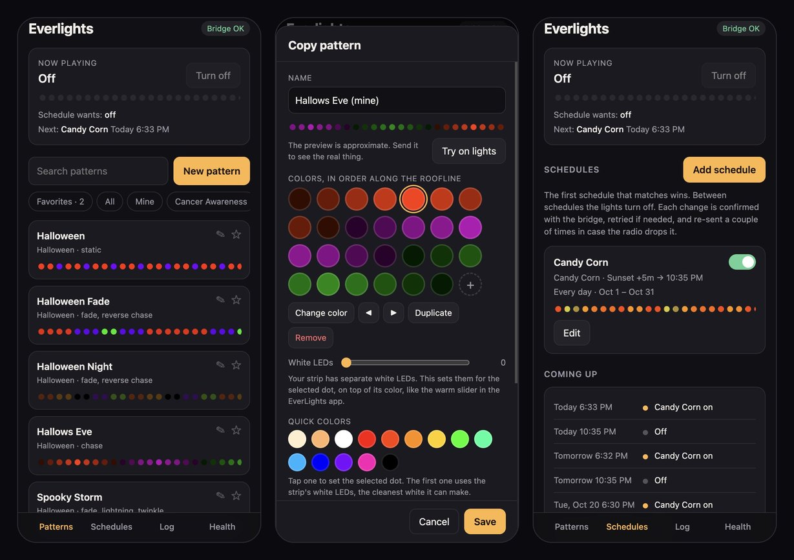
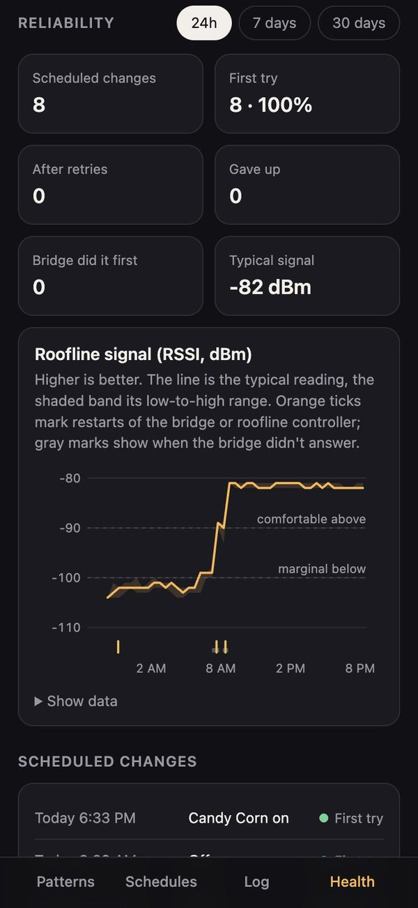

# everlights

A local web app and scheduler for [EverLights](https://www.everlights.com/) permanent
roofline lighting. It talks to the EverLights bridge directly over your home network,
so it doesn't depend on the EverLights cloud or phone app.

I built it because my lights weren't reliably turning on and off on schedule. The
bridge fires each scheduled change once and never checks whether the roofline
controller heard it. This app does the scheduling itself, confirms every change, and
retries until it sticks.



It's built for phones first: add it to your home screen and it opens like an app.

> Not affiliated with or endorsed by EverLights. It uses the bridge's undocumented
> local API, which could change with any firmware update.

## Features

- **Pattern chooser:** every pattern saved on the bridge, with animated previews,
  search, groups and favorites.
- **Pattern maker:** build your own patterns, including the strip's separate white
  LEDs (RGBW), with effects and speeds. Preview on the real lights before saving.
- **Schedules that confirm:** sunset/sunrise with offsets or clock times, weekdays,
  and yearly date ranges (e.g. Oct 1–31). Each change is read back from the bridge,
  retried with backoff, and re-sent 2 and 10 minutes later in case the radio dropped it.
- **Reliability history:** signal strength (RSSI/SNR) over time, bridge and zone
  restarts, and how every scheduled change went: first try, after retries, gave up,
  or already done by the bridge's own schedule.

  

- **Push alerts** via [ntfy](https://ntfy.sh): get a notification on your phone when a
  scheduled change gives up or only worked after retries, when the bridge stops
  answering (and when it's back), or when the bridge or controller restarts.
- **Siri Shortcuts links:** `/go/on`, `/go/off`, `/go/play?name=Candy%20Corn`.
- **Home screen web app** for iOS.
- **CLI** (`everlights.py`) for scripting and poking at the bridge.

Plain Python 3.10+ standard library; the only dependency is `tzdata` in the container.

## Quick start

Find your bridge's IP address (the EverLights app shows it under Settings → Bridge, or
run `./everlights.py discover`), then:

```bash
EVERLIGHTS_HOST=192.168.1.50 LAT=37.7749 LON=-122.4194 python3 server.py
```

Open http://localhost:8080. Schedules, your patterns and the logs are saved in `./data`.

Run the tests with `python3 -m unittest discover -s tests`.

### Configuration

| Variable | Default | |
| --- | --- | --- |
| `EVERLIGHTS_HOST` | (required) | Bridge IP address |
| `LAT`, `LON` | San Francisco | Your location, for sunrise and sunset |
| `TZ` | `America/Los_Angeles` | Time zone |
| `PORT` | `8080` | HTTP port |
| `DATA_DIR` | `./data` | Schedules, patterns, logs and history |
| `REASSERT_MINUTES` | `2,10` | Re-send after each scheduled change |
| `SCHEDULER` | `on` | `off` serves the app without running schedules (for testing) |

The ntfy topic is set in the app's Health tab. Links like `/#schedules` or
`/#health` open a tab directly.

## Running it on a NAS or server

It needs to run somewhere that's always on and on the same network as the bridge.

- **Docker:** edit `compose.yaml` and run `docker compose up -d --build`.
- **QNAP Container Station (no build):** copy this folder to a share, edit the paths
  and settings in `compose.qnap.yaml`, and paste it into Applications → Create. It runs
  the code straight from the share, so updating means copying new files and restarting
  the container.

**Don't expose it to the internet.** Neither the app nor the bridge has any
authentication. Use a VPN such as Tailscale for remote access.

## CLI

```bash
export EVERLIGHTS_HOST=192.168.1.50
./everlights.py discover          # find the bridge on your /24
./everlights.py status            # bridge and zone health
./everlights.py patterns hallow   # search saved patterns
./everlights.py play "Halloween Night"
./everlights.py on FF6600 7E1EFF -e chase:120
./everlights.py off
./everlights.py events            # schedules stored on the bridge
./everlights.py raw GET zones     # any other endpoint
```

## The bridge's local API

The bridge serves unauthenticated JSON at `http://<bridge-ip>/v1/`. Checked against
bridge firmware B4042, radio R3052, zone controller N3063:

| Method | Path | |
| --- | --- | --- |
| GET | `/v1` | Bridge status, network, zones |
| GET | `/v1/zones` | Zone serial, LED count, RSSI/SNR, reboot count, last response |
| GET / POST / DELETE | `/v1/zones/{serial}/sequence` | What's playing / play a pattern / off |
| GET | `/v1/sequences` | Saved patterns (`alias`, `pattern`, `effects`, `colorMode`) |
| GET / DELETE | `/v1/events`, `/v1/events/{id}` | Schedules, with precomputed UTC `occurrences` |

- Colors are `RRGGBB`, or `RRGGBBWW` with `"colorMode": "rgbw"` to drive the white LEDs.
- Effects seen in saved patterns: `bars`, `blink`, `chase`, `fade`, `gradient`,
  `lightning`, `melt`, `pingPong`, `random`, `reverseChase`, `strobe`, `twinkle`, `wipe`.
  Speeds are 0–255, and a pattern can combine two effects.
- There's no brightness endpoint; use darker colors.
- Reading a zone's sequence back only shows what the bridge *accepted*, not what the
  roofline controller received over the radio. That's why the scheduler re-sends.

## Notes on the bridge's SD card

The bridge keeps its schedules and patterns on a microSD card (FAT32): `events/`,
`sequences/`, `firmware/`, `zones.json` and `.bootcount`. If deleting a schedule fails
with **"SD card error"**, the card's filesystem is probably damaged, often from losing
power mid-write. What worked for me:

1. Back up the whole card first. Your computer may write to it as soon as it mounts.
2. **Repair the original card in place** (on a Mac: `diskutil repairVolume`), then
   delete the broken schedule file.
3. Remove the hidden folders macOS adds before putting it back:

   ```bash
   sudo mdutil -i off "/Volumes/NO NAME"
   sudo rm -rf "/Volumes/NO NAME/.Spotlight-V100" "/Volumes/NO NAME/.fseventsd"
   ```

**Don't count on copying the files to a new card.** I tried a freshly formatted card
with an exact copy of the files, first with 4 KB and then with 32 KB clusters like the
original, and with the macOS folders removed. The bridge booted from it and read
`zones.json`, but couldn't list its schedules or patterns ("Failed to get array
stream"). The original card, repaired, worked fine. My guess is the bridge's firmware
doesn't like folders created by macOS, but I haven't pinned it down.

## Credits

- [CWSpear/everlights](https://github.com/CWSpear/everlights), Cameron Spear's
  JavaScript SDK, reverse-engineered the bridge's v1 API from the phone app's traffic.
  This project started from what that SDK documents.
- [ccutrer's gist](https://gist.github.com/ccutrer/8894f62eadeaae145eebbab0a49adb1f)
  covers the older v2-era controller API.

## License

[MIT](LICENSE)
